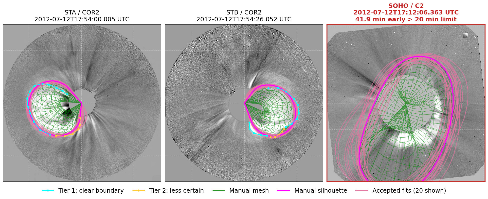
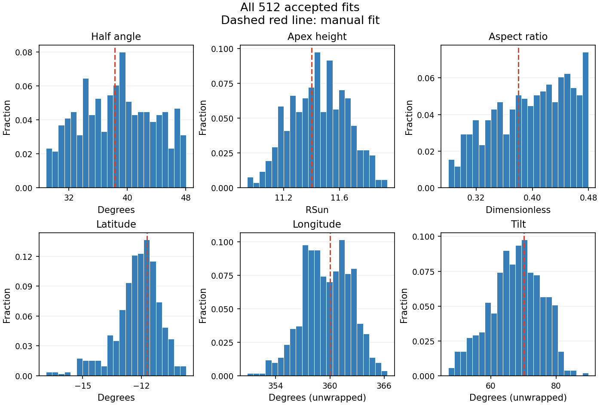

# GCS_with_Uncertainties

Fit CMEs with the GCS model, trace observed boundaries, and search for compatible
parameters. Use any number of coronagraph views and observation times.

## Install and launch

Use Python 3.11 and a graphical desktop.

```sh
git clone https://github.com/talwindersinghphd/GCS_with_Uncertainties.git
cd GCS_with_Uncertainties
conda env create -f environment.yml
conda activate GCS_with_Uncertainties
python launch.py
```

Existing environment: `python -m pip install -r requirements.txt`. JPEG2000
reading also needs the native OpenJPEG library.

<details>
<summary>Ubuntu/Debian display libraries</summary>

```sh
sudo apt-get install libegl1 libopengl0 libxkbcommon-x11-0 libopenjp2-7
```

</details>

## Choose your data

Edit **`EVENT` in [launch.py](launch.py)**. Replace these example dates with your
CME times; all times are **UTC**.

```python
EVENT = {
    'name': 'my_cme',
    'times': ['2024-05-10 18:00', '2024-05-10 18:30'],
    'views': [
        {'spacecraft': 'STA', 'coronagraph': 'COR2'},
        {'spacecraft': 'SOHO', 'coronagraph': 'C2'},
        {'spacecraft': 'SOHO', 'coronagraph': 'C3'},
    ],
    'background': {'mode': 'fixed', 'time': '2024-05-10 17:00'},
    'max_time_offset_minutes': 20,
}
```

Instrument codes are listed in the launcher comments. Images download
automatically and are cached. Backgrounds can be `fixed` (pre-event), `running`
(with `minutes`), or `raw` (no subtraction).

Local FITS: add **`'image_folder': '/path/to/C3_fits/'`** to a view. Subfolders are
searched by FITS observation time on either side of the requested time; available
instrument headers are checked. Use one instrument's folder per view. Backgrounds
come from the same folder, or set `background_folder`. Explicit `image` and
`background_image` files and time templates still work. Maps need helioprojective
WCS and observer metadata, including `DSUN_OBS`. Saved frames keep their cached
selection; use a new event name/output folder to select again after adding files.

Check settings without downloading: `python launch.py --check-config`.
The bundled July 12 STA/STB COR2 example runs offline with its two original
views, time and background.

## Draw, fit, search

1. **Draw Outline:** choose a view and tier. Trace clear boundaries in **cyan
   (Tier 1)** and less certain sections in **yellow (Tier 2)**. Left-click adds
   points; right-click stops. Use **New arc** across gaps, **Undo point** for
   corrections, and segment assignment to change an existing segment's tier.
2. **Manual fit:** adjust the six GCS parameters to follow your traces.
3. **Uncertainty:** choose CPUs and the target number of accepted fits, review the
   settings below, then **Run uncertainty search**. Live counters show tried and
   accepted fits. **Cancel search** keeps partial results.

| Setting | Meaning |
| --- | --- |
| Scale × multiplier | Search ± this range around the manual fit; zero fixes a parameter. |
| History-guided / Broad search | Mix historical angular differences with broad sampling of your ranges. Percentages sum to 100%. |
| Extra RMS allowance | Additional outline mismatch allowed above the manual RMS, separately for each traced view/tier. Defaults: **0.05 RSun / 0.20 RSun** for Tier 1 / Tier 2. |

Each traced view/tier must satisfy **candidate RMS ≤ manual RMS + allowance**.
RSun denotes projected solar radii. Untraced views show the model and accepted
outlines for visual comparison, without imposing acceptance checks.

Use toolbar pan/zoom for individual plots. **Pinch** zooms the whole figure page;
**two-finger scrolling** moves around it. **Fit page** restores the overview.
The **Images** tab has independent **Brightness** and **Contrast** sliders and
number boxes for each view. **Reset this image** restores its original display.
These settings stay available during a search and are saved with each time step;
they change the display without changing image data, traces or accepted fits.

## Read the results



This July 12, 2012 example has **512 accepted fits**, constrained by STA/STB
outlines; 20 are shown. This run used **0.10 / 0.20 RSun**
allowances for Tier 1 / Tier 2.

**Red SOHO C2:** requested **17:54 UTC**, closest image **17:12:06 UTC**—**41.9
minutes early**, beyond the selected **20-minute** threshold. It stays visible
with a red title and border. Here C2 was **untraced**, supplying visual context.
A traced red-marked view still constrains the search.

Live previews update about once a second and keep **every accepted outline found
so far** visible. Completed, cancelled and reopened searches show all their accepted
outlines. **Accepted parameter histograms** includes every accepted fit:



Bars show the **fraction of accepted fits** in each bin; dashed red lines mark
the manual fit. Longitude and tilt are unwrapped around it. These are
**proposal-dependent compatible ranges**, not calibrated confidence intervals.

## Save and move through time

**Save** writes the fit, traces, settings and results, keeping the window open.
**Previous / Next** and closing also save. Each new time starts from the current
parameters and settings but needs fresh outlines; saved times restore their own session.

Outputs go to **`sessions/<event name>/frames/<UTC time>/`**: manual-fit and trace
JSON files, figures, and `gcs_uncertainty_*` folders containing accepted parameters
(CSV/NPZ), summaries and histograms. **`sessions/<event name>/time_series.csv`**
collects the manual parameters across requested times. Sessions and caches stay
out of Git. Each time is fitted independently.

[Outline editing](src/docs/two_tier_workflow.md) ·
[Method](src/docs/method.md) · [Distance units](src/docs/distance_units.md) ·
[Bundled example](src/examples/july12_2012/README.md)

Based on [Johan von Forstner's GCS implementation](https://github.com/johan12345/gcs_python).
Historical guidance uses fits from the [Zenodo dataset](https://zenodo.org/records/5515483)
used in [Singh et al. (2022)](https://doi.org/10.3847/1538-4357/ac73f3).
See [LICENSE](LICENSE) and [NOTICE](NOTICE).
