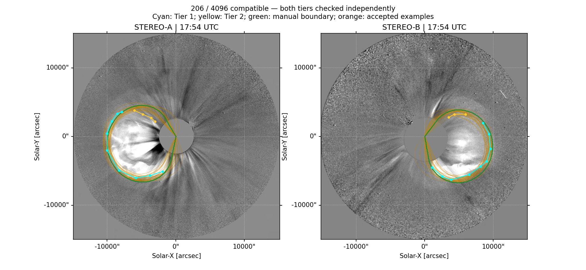

# GCS Outline Uncertainty

Interactive CME reconstruction with manual GCS fitting, two confidence tiers of
observed outlines, and history-guided searches for compatible geometries.



This is a separate project based on
[Talwinder Singh's GCS_Python](https://github.com/talwindersinghphd/GCS_Python),
which derives from [Johan von Forstner's Python GCS implementation](https://github.com/johan12345/gcs_python)
of the Thernisien GCS model. It preserves the manual fitting workflow and adds
outline-based uncertainty exploration.

## What it does

- Overlay a manually adjusted GCS mesh on coronagraph images.
- Draw **Tier 1** arcs on clear boundaries and **Tier 2** arcs on less-certain sections.
- Reassign existing segments between tiers without redrawing them.
- Keep disconnected arcs separate and weight their errors by arclength.
- Explore all six geometric parameters with a mixture of historical fit differences
  and broad sampling, or broad sampling alone.
- Export compatible parameter vectors, per-view/tier errors, diagnostics, and up to
  512 distinct accepted rows.

The rule is deliberately **relative to your manual fit**, separately for every view/tier:

```text
candidate RMS <= manual RMS for the same view/tier + additional allowance
```

Every check must pass. Better Tier 2 agreement cannot compensate for a Tier 1
failure. There is no new absolute distance threshold. Initial additional allowances
are +3 native pixels for Tier 1 and +12 for Tier 2; both are editable starting values.

## Install

Python 3.11 is recommended. Conda provides the native OpenJPEG library used when
reading JPEG2000 coronagraph images:

```sh
git clone https://github.com/talwindersinghphd/GCS_Outline_Uncertainty.git
cd GCS_Outline_Uncertainty
conda env create -f environment.yml
conda activate gcs-outline
```

If you already have the native image libraries and a suitable Python environment:

```sh
python -m pip install -r requirements.txt
```

## Try the saved July 12, 2012 example

```sh
python fit_july12_2012.py
```

The project includes the saved manual fit, both confidence tiers, real STEREO-A/B
COR2 images, and canonical processed image arrays with observer metadata. The
canonical arrays let the example run offline without requiring a JPEG2000 decoder.
Inputs are copied into ignored `sessions/july12_2012/` before editing, preserving
the tracked example.

1. Review the manual fit in **Manual fit**.
2. In **Outline uncertainty**, choose a tier, then draw or reassign segments.
3. Use **Score manual fit only** to inspect each tier's baseline and allowed error.
4. Review ranges, allowances, sampling settings, and candidate count.
5. Choose **Freeze current fit and sample**, then **Save July 12 session** or export.

The example observations are at 17:54:00 and 17:54:26 UTC. A non-simultaneous SOHO
frame is intentionally excluded. The included reference run accepted 206 of 4096
proposals using both tiers. This is an illustrative compatibility result, not a
validated forecast or a target count for other events. Exact generated proposals
can differ between NumPy/SciPy versions; the frozen reference scores are included
for checking the acceptance logic.

[Detailed tier-editing guide](docs/two_tier_workflow.md) ·
[Method and interpretation](docs/method.md) ·
[Example provenance](examples/july12_2012/README.md)

## Other events and an offline synthetic demo

```sh
python gui.py "2012-07-12 17:54" STA STB -stereo COR2 -rd
python demo_uncertainty.py
```

The general GUI downloads images through the inherited Helioviewer/solar-data
workflow and needs network access. Cached images and saved sessions stay out of
Git. The synthetic demo is explicitly labelled and is not a real CME observation.

## Tests

```sh
QT_QPA_PLATFORM=offscreen python -m unittest discover -s tests -v
python scripts/check_reference_run.py
```

The tests cover contour geometry, angular wrapping, physical bounds, historical
sampling, independent tier acceptance, segment reassignment, annotation persistence,
GUI searches, cancellation, and 512-row selection. The reference check verifies the
stored four-component acceptance decisions without rerunning the projections.

## Interpretation

These are **outline-compatible parameter ranges**, not calibrated confidence or
credible intervals. Frequencies depend on the proposal distribution, bounds, and
allowances. Widen bounds when accepted fits approach their limits and assess
sampling, mesh, and raster convergence. The July 12 reference still reaches some
tilt and shape bounds.

This single-time reconstruction estimates neither speed uncertainty nor poloidal
flux. Speed needs multiple height-time reconstructions; magnetic flux needs separate
observational constraints. Preserve complete accepted vectors when using their
joint geometric relationships.

## Attribution

See [NOTICE](NOTICE) and [LICENSE](LICENSE). Historical starting information comes
from the matched GCS reconstructions used in Singh et al. (2022),
[ApJ 933, 123](https://doi.org/10.3847/1538-4357/ac73f3). Observer/catalog disagreement
is not ground-truth reconstruction error.
